  

 

  

 

  

 

> *"Contributing back to the community and learning through collaboration."*

  

<b>📜 Quest details (links)</b>

 

| Guild | Quest | Status |
| :---: | :--- | :---: |
|  | [#32953](https://github.com/dagster-io/dagster/pull/32953) Handle `InputDefinition` objects when mapping asset specs |  |
|  | [#32841](https://github.com/dagster-io/dagster/pull/32841) Fix `FileExistsError` on Windows during dbt project reload |  |
|  | [#32948](https://github.com/dagster-io/dagster/pull/32948) Fix `IndexError` when an ECS task fails to launch in `PipesECSClient` |  |
|  | [#32650](https://github.com/dagster-io/dagster/pull/32650) Handle callables with a custom `__signature__` in `get_type_hints` |  |
|  | [#32444](https://github.com/scikit-learn/scikit-learn/pull/32444) Switch to absolute imports in `_datasets_pair.pxd.tp` |  |
|  | [#32445](https://github.com/scikit-learn/scikit-learn/pull/32445) Switch to absolute imports in `_datasets_pair.pyx.tp` |  |
|  | [#30277](https://github.com/numpy/numpy/pull/30277) Fix misleading `ValueError` in `convolve` on empty inputs |  |

 

   
  <picture>
    <source media="(prefers-color-scheme: dark)" srcset="https://raw.githubusercontent.com/Jongwan93/Jongwan93/output/github-snake-dark.svg" />
    <source media="(prefers-color-scheme: light)" srcset="https://raw.githubusercontent.com/Jongwan93/Jongwan93/output/github-snake.svg" />
    
  </picture>

 

  

<!-- Pixel art is generated by scripts/generate_assets.py — edit there and re-run. -->
